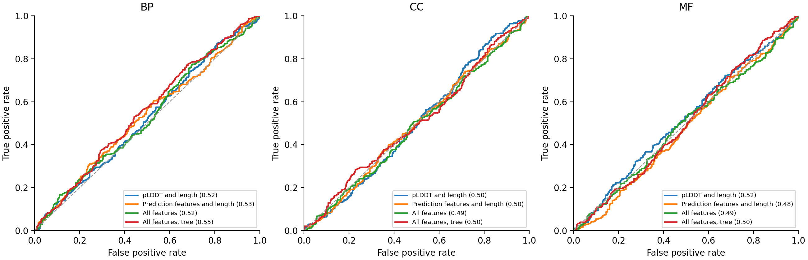

# Predicting when pLDDT helps fusion

The experts use the same sequence and structural inputs and architecture. The intervention is pLDDT in graph attention and residue fusion. The model checkpoints use the stopping subset of validation. The remaining validation proteins are divided into predictor fitting and operating-point subsets, grouping duplicate protein sequences together. Test labels are used only to score the frozen rules.

The regression target is the change in per-protein F1 between the aligned-confidence and neutral experts. Each expert threshold used to define this target is selected on predictor-fitting proteins. The predictor uses pLDDT statistics, length, prediction entropy and disagreement. Ridge regularization is fixed at 10. The routing cutoff and final prediction threshold are selected on the operating-point subset. A fixed blend tuned on the same subset is the main routing comparator.

The primary benefit model is ridge regression. The exploratory nonlinear extension uses 80 shallow boosted trees of depth two, minimum leaf size 40 and L2 regularization 10. This extension was added after the initial MFO linear predictor scored near chance. All listed models are reported.

## Expert performance

| Branch | Test proteins | Fusion without pLDDT Fmax | Fusion with pLDDT Fmax | Static blend Fmax |
| --- | --- | --- | --- | --- |
| BP | 1044 | 0.5618 | 0.5588 | 0.5677 |
| CC | 1098 | 0.7436 | 0.7411 | 0.7450 |
| MF | 937 | 0.7563 | 0.7570 | 0.7682 |

The expert table above uses seed 2. The corrected seed 1 archived results provide a second matched comparison.

| Branch | pLDDT Fmax change, seed 1 (points) | pLDDT Fmax change, seed 2 (points) |
| --- | --- | --- |
| BP | -0.11 | -0.30 |
| CC | +0.14 | -0.25 |
| MF | +0.17 | +0.06 |

## Predicting which expert helps

AUROC compares positive and negative per-protein F1 changes. Exact ties are excluded. Intervals resample test proteins and condition on the fitted expert and regression models. A value of 0.5 is chance discrimination.

| Branch | Predictor | Help-versus-harm AUROC | 95% protein bootstrap interval |
| --- | --- | --- | --- |
| BP | Length | 0.525 | [0.488, 0.563] |
| BP | pLDDT and length | 0.522 | [0.483, 0.557] |
| BP | Prediction features and length | 0.529 | [0.493, 0.566] |
| BP | All features | 0.524 | [0.486, 0.559] |
| BP | Shuffled pLDDT | 0.517 | [0.482, 0.551] |
| BP | pLDDT and length, tree | 0.535 | [0.499, 0.570] |
| BP | Prediction features and length, tree | 0.526 | [0.491, 0.562] |
| BP | All features, tree | 0.548 | [0.513, 0.582] |
| BP | Shuffled pLDDT, tree | 0.523 | [0.486, 0.558] |
| CC | Length | 0.502 | [0.465, 0.545] |
| CC | pLDDT and length | 0.501 | [0.460, 0.541] |
| CC | Prediction features and length | 0.496 | [0.457, 0.541] |
| CC | All features | 0.488 | [0.450, 0.528] |
| CC | Shuffled pLDDT | 0.492 | [0.452, 0.534] |
| CC | pLDDT and length, tree | 0.486 | [0.449, 0.529] |
| CC | Prediction features and length, tree | 0.493 | [0.451, 0.536] |
| CC | All features, tree | 0.503 | [0.463, 0.545] |
| CC | Shuffled pLDDT, tree | 0.479 | [0.440, 0.517] |
| MF | Length | 0.489 | [0.443, 0.534] |
| MF | pLDDT and length | 0.519 | [0.475, 0.563] |
| MF | Prediction features and length | 0.479 | [0.438, 0.527] |
| MF | All features | 0.494 | [0.451, 0.537] |
| MF | Shuffled pLDDT | 0.494 | [0.453, 0.534] |
| MF | pLDDT and length, tree | 0.542 | [0.500, 0.586] |
| MF | Prediction features and length, tree | 0.478 | [0.432, 0.522] |
| MF | All features, tree | 0.502 | [0.461, 0.550] |
| MF | Shuffled pLDDT, tree | 0.482 | [0.439, 0.522] |

## Routing performance

| Branch | Predictor | Use pLDDT fraction | Fixed F1 | F1 gain over static blend | 95% interval |
| --- | --- | --- | --- | --- | --- |
| BP | Length | 100.0% | 0.5580 | -0.0093 | [-0.014, -0.004] |
| BP | pLDDT and length | 100.0% | 0.5580 | -0.0093 | [-0.014, -0.004] |
| BP | Prediction features and length | 100.0% | 0.5580 | -0.0093 | [-0.014, -0.004] |
| BP | All features | 100.0% | 0.5580 | -0.0093 | [-0.014, -0.004] |
| BP | Shuffled pLDDT | 100.0% | 0.5580 | -0.0093 | [-0.014, -0.004] |
| BP | pLDDT and length, tree | 100.0% | 0.5580 | -0.0093 | [-0.014, -0.004] |
| BP | Prediction features and length, tree | 100.0% | 0.5580 | -0.0093 | [-0.014, -0.004] |
| BP | All features, tree | 100.0% | 0.5580 | -0.0093 | [-0.014, -0.004] |
| BP | Shuffled pLDDT, tree | 100.0% | 0.5580 | -0.0093 | [-0.014, -0.004] |
| CC | Length | 100.0% | 0.7379 | -0.0041 | [-0.006, -0.002] |
| CC | pLDDT and length | 81.1% | 0.7394 | -0.0026 | [-0.005, -0.000] |
| CC | Prediction features and length | 100.0% | 0.7379 | -0.0041 | [-0.006, -0.002] |
| CC | All features | 100.0% | 0.7379 | -0.0041 | [-0.006, -0.002] |
| CC | Shuffled pLDDT | 100.0% | 0.7379 | -0.0041 | [-0.006, -0.002] |
| CC | pLDDT and length, tree | 100.0% | 0.7379 | -0.0041 | [-0.006, -0.002] |
| CC | Prediction features and length, tree | 100.0% | 0.7379 | -0.0041 | [-0.006, -0.002] |
| CC | All features, tree | 100.0% | 0.7379 | -0.0041 | [-0.006, -0.002] |
| CC | Shuffled pLDDT, tree | 41.3% | 0.7407 | -0.0013 | [-0.004, 0.001] |
| MF | Length | 100.0% | 0.7560 | -0.0115 | [-0.017, -0.007] |
| MF | pLDDT and length | 100.0% | 0.7560 | -0.0115 | [-0.017, -0.007] |
| MF | Prediction features and length | 74.1% | 0.7586 | -0.0089 | [-0.013, -0.004] |
| MF | All features | 71.4% | 0.7582 | -0.0093 | [-0.014, -0.004] |
| MF | Shuffled pLDDT | 73.4% | 0.7582 | -0.0092 | [-0.013, -0.005] |
| MF | pLDDT and length, tree | 100.0% | 0.7560 | -0.0115 | [-0.017, -0.007] |
| MF | Prediction features and length, tree | 77.4% | 0.7543 | -0.0132 | [-0.018, -0.008] |
| MF | All features, tree | 48.1% | 0.7549 | -0.0126 | [-0.017, -0.008] |
| MF | Shuffled pLDDT, tree | 76.0% | 0.7534 | -0.0141 | [-0.019, -0.009] |

## Descriptive confidence strata

| Branch | Mean pLDDT | n | Aligned minus neutral fixed F1 | 95% interval |
| --- | --- | --- | --- | --- |
| BP | below 70 | 257 | +0.0033 | [-0.008, 0.014] |
| BP | 70 to 90 | 602 | -0.0031 | [-0.011, 0.005] |
| BP | at least 90 | 185 | -0.0147 | [-0.028, -0.000] |
| CC | below 70 | 285 | -0.0055 | [-0.013, 0.002] |
| CC | 70 to 90 | 635 | -0.0035 | [-0.009, 0.002] |
| CC | at least 90 | 178 | -0.0061 | [-0.018, 0.005] |
| MF | below 70 | 247 | -0.0110 | [-0.026, 0.003] |
| MF | 70 to 90 | 513 | +0.0061 | [-0.004, 0.017] |
| MF | at least 90 | 177 | -0.0025 | [-0.021, 0.016] |

The F1 routing metric is the protein-centric dataset F1 at a validation-selected threshold. It differs from the individual-protein F1 regression target. These analyses use one new expert seed and reused archived test proteins. Their results are exploratory and have not been confirmed on a new external cohort. Regression coefficients describe associations conditional on the other input features. A confidence-specific interpretation of blend gains requires a matched ensemble of neutral models.
